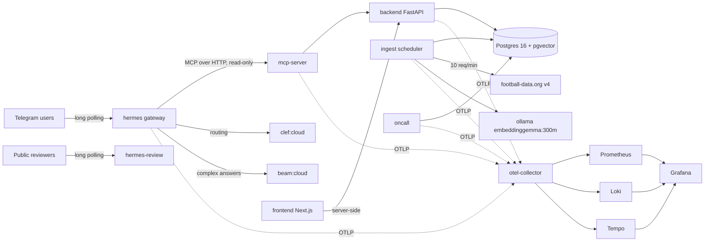

# Hermes Football

A Telegram agent that answers football questions accurately. Facts come from a local Postgres database refreshed
daily from the free football-data.org API; rules and definitions come from a small hand-written notes corpus. Every
answer says how old the data is and cites its source. When the data cannot support an answer, the bot says so.

Status: **built through M6 — operations.** The routing gate is measured on an independent holdout, the MCP tools and
Telegram gateway work end to end, the notes corpus is indexed, the dashboard serves seven routes over the same
contract, `make eval` scores a 48-question golden set into a stored scoreboard, and CI, observability, one actionable
alert, the on-call digest and the security artifacts are in place. The public review bot is
[@review_soccer_bot](https://t.me/review_soccer_bot) (`reviewsoccerbot`).

Try it: open the bot, send `/start`, then ask:
- `where are Arsenal in the table?` — a database answer with a timestamp.
- `how does the championship playoff work?` — a notes answer with a public link.
- `Compare Arsenal's league position with their recent form and say whether they are in the title race.` — a
  complex answer that combines two tools.

Local reviewer runbook: [`_docs/setup-and-review.md`](_docs/setup-and-review.md#local-test-runbook).

## Architecture



## Dashboard and API contract

The dashboard is a Next.js app over the same 19-operation contract the agent uses (v0.4.1): freshness first, then
standings, fixtures, the masked audit log with its one admin write, and the golden-question scoreboard. It renders
server-side, so no API token reaches the browser, and every factual page carries its data timestamp and source. The
API serves `openapi.yaml` verbatim, so the Swagger UI at `/docs` shows the reviewed contract rather than a second,
generated one.

Screenshots of the Telegram bot, all seven dashboard pages and both Swagger views: [`_docs/gallery.md`](_docs/gallery.md).

## Dashboards and key pages

| Surface | URL | What to look at |
| --- | --- | --- |
| **Product dashboard** (`:3000`) | | |
| Dashboard (freshness home) | <http://localhost:3000> | overall status, per-competition age, recent runs, next scheduled run |
| Standings | <http://localhost:3000/standings> | table explorer with `data_as_of` and the source |
| Fixtures and results | <http://localhost:3000/fixtures> | fixtures, results and match detail |
| Agent audit log | <http://localhost:3000/turns> | route, source, confidence, latency; message text masked; the review form when `API_ADMIN_TOKEN` is set |
| Eval scoreboard | <http://localhost:3000/evals> | one series per golden set, the 0.90 target and the stored red run |
| Eval run detail | `http://localhost:3000/evals/{runId}` | per-question misses and the stored metrics |
| System | <http://localhost:3000/system> | API health, version, schema revision |
| Liveness | <http://localhost:3000/healthz> | static probe; does not touch the API |
| **API** (`:8000`) | | |
| Swagger UI | <http://localhost:8000/docs> | the reviewed contract served verbatim |
| Contract file | <http://localhost:8000/openapi.yaml> | `openapi.yaml` v0.4.1 |
| API health | <http://localhost:8000/health> | status, version, database schema revision |
| Freshness JSON | <http://localhost:8000/meta/freshness> | the report the dashboard reads (bearer token required) |
| **Observability** (`:3001`, `make obs-up`) | | |
| Grafana home | <http://127.0.0.1:3001> | datasources and the provisioned dashboards |
| Overview | <http://127.0.0.1:3001/d/hermes-overview> | API, gateway, MCP, ingest, alert state and Loki logs |
| Freshness & alert | <http://127.0.0.1:3001/d/hermes-freshness> | data age per competition, alert timeline, on-call logs |
| Explore | <http://127.0.0.1:3001/explore> | Tempo traces, Loki logs, Prometheus metrics |
| **Telegram** | | |
| Public review bot | <https://t.me/review_soccer_bot> | the same pipeline, without a local browser |

## Models and technologies

### Models

| Name | Type | Deployed | Role |
| --- | --- | --- | --- |
| `clef:cloud` | Decision | Cloud | Routes each message: road, tool, safety, simple or complex |
| `beam:cloud` | GenAI | Cloud | Plans tools, writes complex answers, checks their claims |
| `embeddinggemma:300m` | Embedding | Local | Embeds notes and queries for retrieval (768-d) |

There is no model judge and no model in the on-call agent: evaluation is deterministic and the digest is SQL.

### Technologies

| Name | Type | Role |
| --- | --- | --- |
| Postgres 16 + pgvector | Database, vector store | Football data, run ledger, turns, note embeddings, eval history |
| FastAPI | Web framework | Serves the 19-operation API |
| SQLAlchemy + Alembic | ORM, migrations | Schema and queries (migrations 0001–0004) |
| Next.js + React + TypeScript | Frontend | Dashboard over the same API |
| Ollama | Model server | Local embeddings, and the host proxy for the cloud models |
| Docker Compose | Runtime | Eight services by default, five more with the opt-in obs profile |
| MCP over HTTP | Protocol | Read-only tool surface for the agent |
| Telegram Bot API | Interface | Public bot, long polling |
| httpx | HTTP client | Ingest, MCP and model calls |
| OpenTelemetry → Prometheus/Loki/Tempo → Grafana | Observability | Opt-in traces, metrics and logs on loopback |
| GitHub Actions | CI/CD | Pull-request gates, nightly audits, no eval in CI |
| pytest, ruff, Vitest, Playwright, gitleaks, pip-audit, trivy | Tests, lint, scans | The local gates and the security artifacts |

## Run it

Prerequisite: Docker, this repository, `.env` (`make setup` once).

```bash
make up              # db, ollama, backend, frontend, mcp-server, hermes, ingest, oncall
make ask Q="how does the championship playoff work?"
make test            # unit + contract drift (no network)
make lint
make itest           # integration against the running stack
make frontend-test   # dashboard lint, typecheck, Vitest
make e2e             # Playwright against the running dashboard
make eval-self-check # prove the eval gate can fail, no model needed
make eval            # full golden-question run (cloud routing; owner action)
make ci              # local parity with the pull-request gates
make security-scan   # gitleaks + pip-audit + pnpm audit
make obs-up          # opt-in observability stack (Grafana on 127.0.0.1:3001)
make down
```

One `make up` starts eight services: `db`, `ollama`, `backend`, `frontend`, `mcp-server`, `hermes`, `ingest` and
`oncall`. Only `backend` (`:8000`) and `frontend` (`:3000`) publish host ports; the dashboard fetches server-side, so no
token reaches a browser. Reproducing the agent end to end needs a signed-in Ollama account with cloud access to
`clef:cloud` and `beam:cloud`; the tests and the dashboard do not. Review bot setup, the dashboard walk-through and the
Telegram test steps are in [`_docs/setup-and-review.md`](_docs/setup-and-review.md).

## Observability (opt-in)

```bash
make obs-up     # 5 containers, ~1.4 GB / 1.75 CPU, 7-day retention
make obs-down   # stop it; app containers return to telemetry-off
make telemetry-smoke
```

The URLs and what each shows are in [Dashboards and key pages](#dashboards-and-key-pages).

Grafana is loopback-only, anonymous Viewer and has no login: never tunnel it. The alert is evaluated by `oncall`
against Postgres, not by Grafana, so it still works when the obs stack is down. Telemetry is push-only to a local
collector on an internal network; it carries route/tool/status/latency, never a message, answer, chat id or token.
Details, signal matrix and troubleshooting: [`observability/README.md`](observability/README.md).

## Repository map

```text
.
├── README.md, AGENTS.md, CLAUDE.md        entry point, agent rules, operational rules
├── openapi.yaml                          API contract, v0.4.1 (19 operations)
├── docker-compose.yml, docker-compose.observability.yml, Dockerfile, Makefile
├── .github/                              CI, nightly scans, Dependabot, PR template
├── _docs/                                setup, scoping, product spec, decisions, follow-ups, AI usage
├── backend/                              FastAPI API over Postgres (one admin write, one documented 404)
├── db/                                   SQLAlchemy models, Alembic migrations (0001–0004)
├── ingest/                               football-data.org client, loaders, scheduler, knowledge index
├── mcp_server/                           eight read-only MCP tools over HTTP
├── frontend/                             Next.js dashboard: freshness, tables, turns, evals, system
├── agent/                                router, gate, planner/composer, turn writer, Telegram gateway, on-call
├── hermes/                               SOUL.md, config.yaml, notes and manifest
├── telemetry/                            OTel setup, metrics and the no-op-when-off contract
├── observability/                        collector, Prometheus, Loki, Tempo, Grafana dashboards
├── security/                             capability table, threat model, scan policy and baseline
├── ops/                                  runbooks and incident-drill evidence
├── evals/routing/, evals/golden/        routing holdout and the scoreboard
└── tests/                                unit, integration, policy and contract tests
```

## How the 12 criteria are covered

| # | Criterion | Status | Evidence |
| --- | --- | --- | --- |
| 1 | Problem description | Met | [`_docs/scoping.md`](_docs/scoping.md) §1–3 |
| 2 | Product specification | Partly | [`_docs/product-spec.md`](_docs/product-spec.md), [`openapi.yaml`](openapi.yaml), [`_docs/scoping.md`](_docs/scoping.md) §8. Gap: no public task tracker |
| 3 | Agent team | Met | [`_docs/agent-team.md`](_docs/agent-team.md), [`prompts/`](prompts/README.md), [`_docs/ai-usage-report.md`](_docs/ai-usage-report.md) |
| 4 | Context management | Met | [`AGENTS.md`](AGENTS.md), [`_docs/`](_docs), decisions and follow-ups |
| 5 | Application | Met | Backend, MCP tools, agent, ingestion, dashboard and on-call: [`backend/`](backend), [`agent/gateway/`](agent/gateway), [`agent/oncall/`](agent/oncall), [`mcp_server/`](mcp_server) |
| 6 | Testing | Met | `make test` (450), `make itest` (41), `make frontend-test` (27), `make e2e` (6), contract drift, eval self-check, capability/compose policy tests |
| 7 | Containerization | Met | `make up` starts eight services with health checks; two published ports; opt-in obs profile with five more. [`docker-compose.yml`](docker-compose.yml) |
| 8 | Deployment | Partly | Telegram long polling; the dashboard runs locally and a tunnel is demo-only. Gap: no permanent public host |
| 9 | CI/CD | Met | [`.github/workflows/ci.yml`](.github/workflows/ci.yml), nightly scans, `make ci` local parity |
| 10 | Observability | Met | [`observability/`](observability), `make obs-up`, two Grafana dashboards, traces/logs/metrics for five services |
| 11 | Alerting | Met | `ingest_unhealthy` in [`agent/oncall/alerts.py`](agent/oncall/alerts.py), drill in [`ops/drills/`](ops/drills/2026-10-27-ingest-stale.md) |
| 12 | On-call agent | Met | [`agent/oncall/`](agent/oncall), daily digest and alert loop, read-only and no model |

The detailed map with gaps is [`_docs/scoping.md`](_docs/scoping.md#5-how-the-12-course-criteria-are-covered).

## The agent in one minute

1. `clef:cloud` reads the message and labels the road (`tool`, `knowledge`, `clarify`, `refuse`), the tool, safety,
   and `simple` or `complex`.
2. Any safety label other than `safe` refuses before a tool or note is touched.
3. Simple: one tool or one note retrieval, deterministic answer.
4. Complex: planner chooses up to four tools, or retrieves eight notes, and `beam:cloud` composes with a citation
   check and a deterministic fallback.
5. The turn is written to `agent_turns` through an insert-only role, then sent.

Only the user message goes to `clef:cloud`. Simple answers stay local; complex answers send the collected results to
`beam:cloud`. Embeddings and note retrieval stay local. M6 adds no data egress: telemetry is local, and the owner
Telegram alert channel is opt-in and metadata-only.

## Documents

- [`_docs/setup-and-review.md`](_docs/setup-and-review.md) — launch, reviewer test, owner Telegram setup, observability checks
- [`_docs/scoping.md`](_docs/scoping.md) — problem, data limits, criteria map, plan
- [`_docs/product-spec.md`](_docs/product-spec.md) — requirements, acceptance criteria, milestones
- [`_docs/follow-ups.md`](_docs/follow-ups.md) — the recorded gaps, with next steps
- [`_docs/rag.md`](_docs/rag.md) — notes, chunking, embeddings, retrieval
- [`_docs/data-model.md`](_docs/data-model.md) — tables and open items
- [`_docs/gallery.md`](_docs/gallery.md) — the dashboard and the served contract, in screenshots
- [`_docs/notes-sources.md`](_docs/notes-sources.md) — source URLs for every note
- [`_docs/agent-team.md`](_docs/agent-team.md) — roles and process
- [`_docs/permissions.md`](_docs/permissions.md) — every capability, its role and its bound
- [`_docs/ai-usage-report.md`](_docs/ai-usage-report.md) — what agents did, what humans caught
- [`_docs/decisions/`](_docs/decisions/README.md) — decisions not to re-litigate
- [`security/`](security/README.md) — capability table, threat model, scans
- [`ops/`](ops/README.md) — runbooks and incident evidence
- [`observability/`](observability/README.md) — signals, cost, dashboards
- [`evals/routing/results/`](evals/routing/results/) — routing evidence

## Limits, stated

- No dashboard login; the tunnel is demo-only, and a permanent host is a follow-up. Grafana is loopback-only.
- Golden-set scoring is deterministic (no model judge): completeness means the required terms are present, not that the
  prose is good. The newest live run is stored red with its misses rather than tuned green.
- The three eval-surfaced agent misses (resolver, two `clarify`, one fabricated) are recorded follow-ups; M6 changed no
  prompt, model or label.
- The ingest trigger (`POST /admin/ingest-runs`) is a documented `404` until the queue follow-up lands.
- No multi-turn memory; each message routes on its own.
- Top-scorer data is served; lineups, odds, live scores and xG are not available on the free tier.
- The free provider is delayed; never presented as live.
- No licence is chosen; the repository is all-rights-reserved until the owner picks one.
