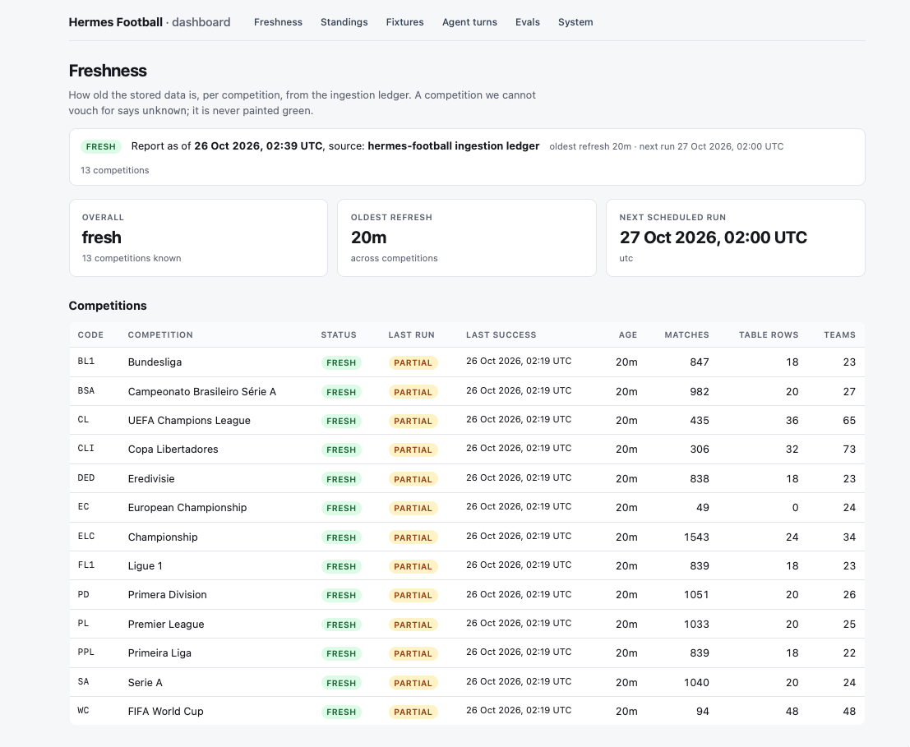
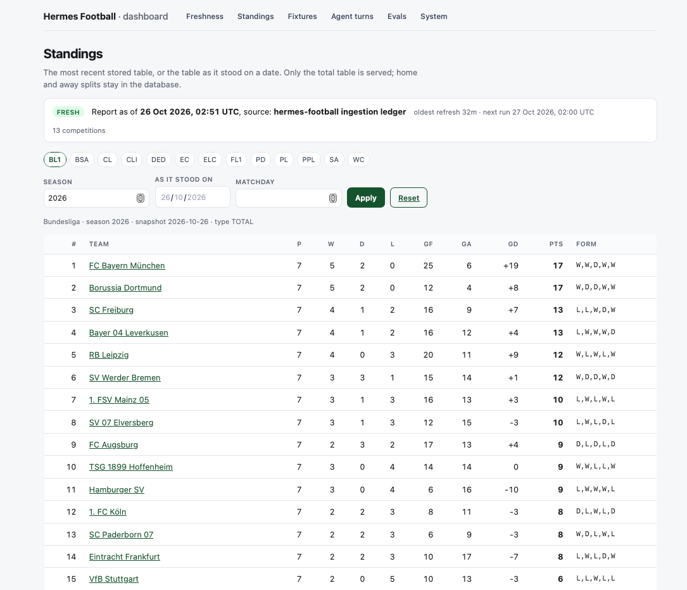
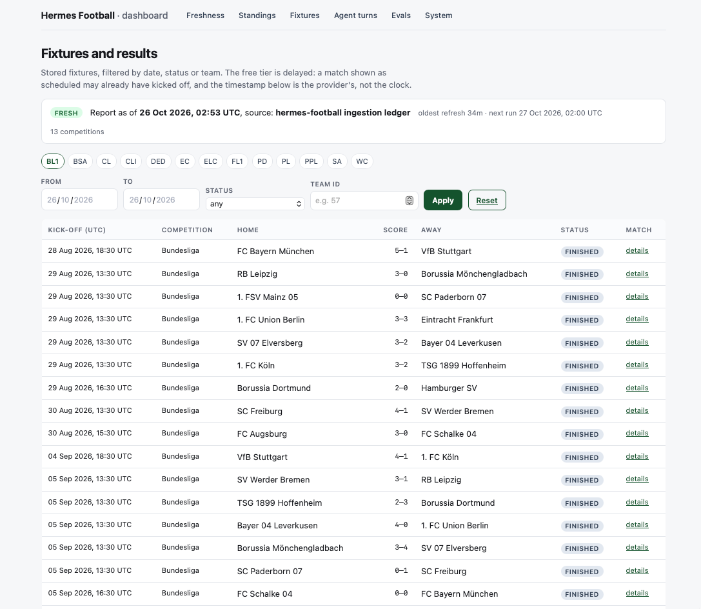
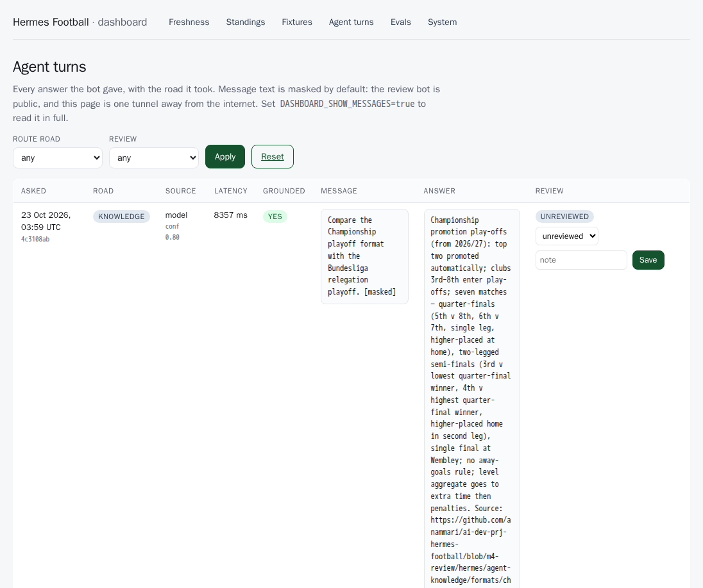
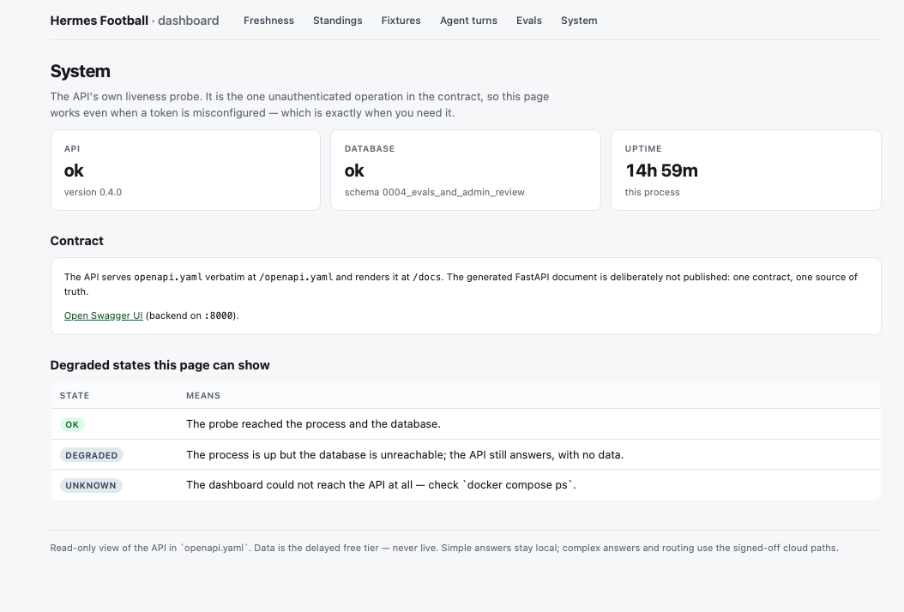
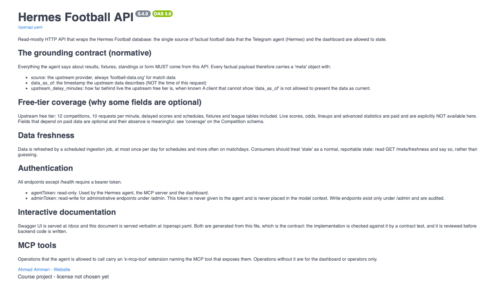
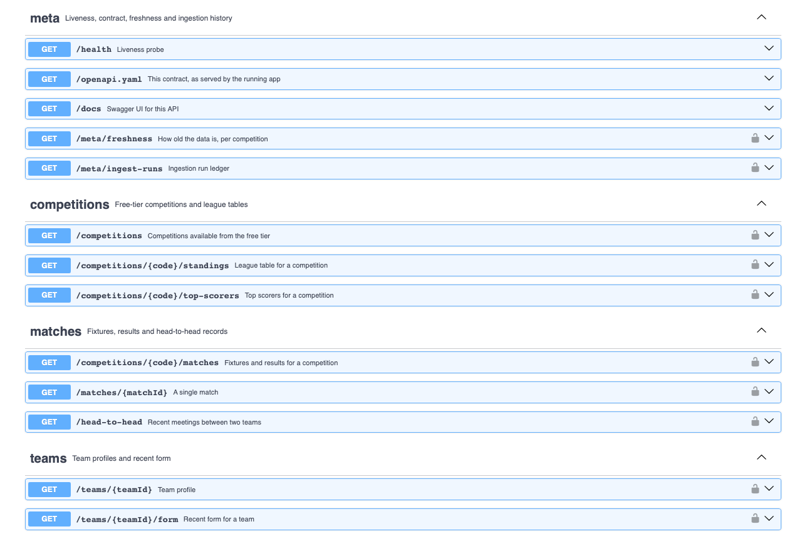

# Gallery — the dashboard and the served API contract

Screenshots from a local `make up` on 26 October 2026, on the retained volume. The free tier is delayed, so every
timestamp here is the provider's, never the clock. Nothing in these pages is mocked: they are the app reading the same
`openapi.yaml` the agent reads.

## Dashboard

Seven server-rendered routes. The browser gets HTML and no token; each factual page carries its `data_as_of` and
source, because a number without its age is a guess.

### Freshness — the landing page

How old the stored data is, per competition, computed from the ingestion ledger. All thirteen are `fresh` with a 20
minute age; every `last run` is `partial` because EC's standings return 404 on the free tier — an expected state that
is shown, not painted green. `unknown` is a distinct verdict for a competition nothing has vouched for.

### Standings — a stored table, or the table as it stood

The Bundesliga table with a point-in-time snapshot selected. Only the total table is served; home and away splits stay
in the database. Goal difference is a signed integer, and the page names the snapshot its rows describe in the
provenance line below the fold.

### Fixtures and results — dates, scores and status

The season's stored matches, filtered by competition, date range, status or team. The note above the table is the point:
a fixture shown as scheduled may already have kicked off, and the stamp is the provider's, not the browser's clock.

### Agent turns — the audit log, with the one write

Every answer the bot gave, with the road it took. Message text is masked by default — the review bot is public, and this
page is one tunnel away from the internet. The review control is the only write in the product: admin token, two
columns, recorded on the row.

### Evaluation scoreboard — the golden set over time

Five runs: three live on the 48-question golden set, all failing their gate on completeness or citations, and two
backfilled M4 holdout runs imported as the baseline. One line per set **hash**, because a score on a different sample is
not a continuation of the same trend; the hollow point is a run that failed. The red is the deliverable, not a defect.

### System — the API's own probe

The one unauthenticated operation in the contract, and the page that still works when a token is misconfigured. Schema
revision `0004_evals_and_admin_review` is the same one the migration created.

## API contract

`openapi.yaml` is served verbatim at `/openapi.yaml` and rendered at `/docs`. The generated FastAPI document is
deliberately not published: one contract, one source of truth, checked by a drift test.

### The served description

The document's own front matter: what every factual response must carry (`source`, `data_as_of`,
`upstream_delay_minutes`), why some fields are optional, the two tokens and their scopes, and the `x-mcp-tool`
convention that marks the operations the agent may call.

### The operations

Operations grouped by tag, with a padlock on each one that needs the bearer token. `/health`, `/openapi.yaml` and
`/docs` are the only open ones; the eval reads and the admin write carry no `x-mcp-tool`, so the agent can never read
its own score or review itself.

## The bot

The avatar of the public review bot, [@review_soccer_bot](https://t.me/review_soccer_bot).
